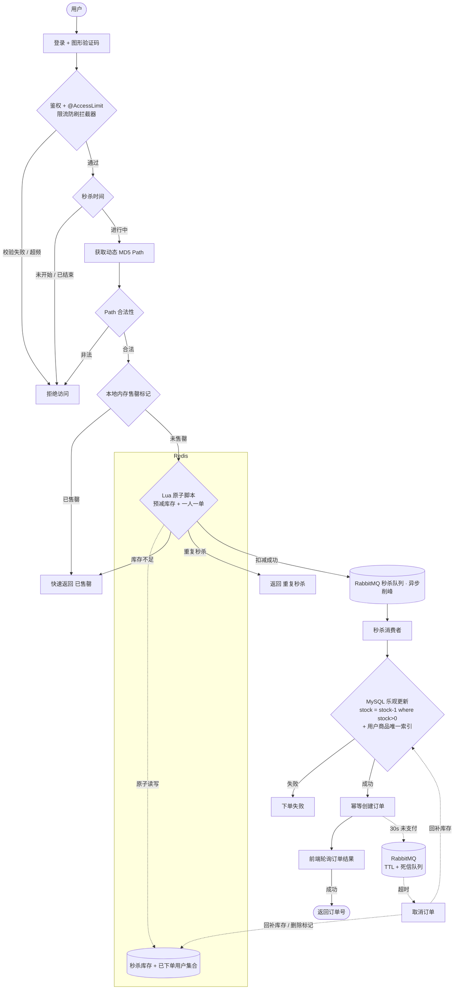

# 🔥 SpringBoot 高并发秒杀系统（springboot-seckill）

> 一个可真实编译运行的电商秒杀后端作品集项目，围绕「**高并发、防超卖、异步削峰、接口安全**」完整实现，适合作为简历 / 接单作品展示。

## ✨ 项目亮点

- **Redis Lua 原子预减库存**：库存扣减 + 一人一单判断在一段 Lua 脚本中原子完成，避免并发竞态。
- **RabbitMQ 异步下单削峰**：秒杀请求先在 Redis 预减库存，再投递 MQ 立即返回「排队中」，数据库按消费能力平滑落库。
- **Lua + DB 双重防超卖**：Redis 预减之外，落库时用 `update ... set stock=stock-1 where stock>0` 条件更新兜底；订单表 `(user_id, goods_id)` 唯一索引保证一人一单。
- **本地内存售罄标记**：`ConcurrentHashMap` 标记已售罄商品，售罄后直接快速失败，减少无效 Redis 访问。
- **隐藏秒杀接口地址**：秒杀开始后服务端才下发基于 `用户+商品+服务端盐` 的 MD5 动态 path，接口路径不可提前猜测。
- **接口防刷**：自定义 `@AccessLimit` 注解 + 拦截器，基于 Redis 计数，按「用户/IP + URL」做时间窗口限流（默认 5 秒 5 次）。
- **图形验证码**：Hutool 生成干扰线验证码，答案存 Redis 一次性校验，阻挡机器人脚本。
- **死信队列超时关单**：下单后发送 30s TTL 延迟消息，未支付订单自动取消并**回补 Redis + DB 库存**。
- **登录态鉴权**：手机号 + 加盐 MD5 密码登录，token 存 Redis、写入 Cookie，拦截器统一校验。
- **统一工程规范**：`Result<T>` 统一返回、错误码枚举、`@RestControllerAdvice` 全局异常处理、SpringDoc 接口文档。

---

## 🧱 技术栈

| 分类 | 选型 | 版本 |
| --- | --- | --- |
| 语言 / 构建 | JDK、Maven | JDK 1.8、Maven 3.9.x |
| 基础框架 | Spring Boot | 2.7.18 |
| ORM | MyBatis Spring Boot Starter | 2.3.2 |
| 数据库 | MySQL（兼容 5.7 / 8.x） | Connector/J 8.0.33 |
| 连接池 | HikariCP | Spring Boot 默认 |
| 缓存 | Spring Data Redis（Lettuce） | 随 Spring Boot |
| 消息队列 | Spring AMQP（RabbitMQ） | RabbitMQ 3.x |
| 页面 | Thymeleaf | 随 Spring Boot |
| 参数校验 | spring-boot-starter-validation | 随 Spring Boot |
| 工具库 | Hutool-all、commons-lang3、Guava | Hutool 5.8.27 |
| 接口文档 | springdoc-openapi-ui | 1.7.0 |
| 样板代码 | Lombok | 随 Spring Boot（provided） |

---

## 🏗️ 整体架构与高并发方案

```
                          ┌─────────────────────────────┐
                          │   浏览器（列表/详情/倒计时）   │
                          └──────────────┬──────────────┘
                                         │ 1.验证码 2.取动态path 3.发起秒杀 4.轮询结果
                                         ▼
                    ┌──────────────────────────────────────────┐
                    │             Spring Boot 应用              │
                    │  @AccessLimit 限流 → 登录态 → path 校验    │
                    │  本地售罄标记 ConcurrentHashMap（快速失败） │
                    └──────────────┬───────────────────────────┘
                                   │ Lua 原子：判重复 + DECR 库存
                                   ▼
                          ┌─────────────────┐
                          │      Redis      │  stock / bought / token / path / captcha / result / access
                          └─────────────────┘
                                   │ 预减成功后发送下单消息
                                   ▼
                          ┌─────────────────┐
                          │    RabbitMQ     │  seckill.direct → seckill.queue
                          └──────────┬──────┘
                                     │ 消费者按能力拉取
                                     ▼
                    ┌──────────────────────────────────────────┐
                    │  幂等校验 → DB 条件扣库存(where stock>0)   │
                    │  → 创建订单 → 写秒杀结果 → 发 TTL 延迟消息  │
                    └──────────────┬───────────────────────────┘
                                   ▼
                          ┌─────────────────┐
                          │      MySQL      │  user / goods / order（唯一索引 uk_user_goods）
                          └─────────────────┘

   超时关单旁路：seckill.ttl.queue（30s TTL）→ seckill.dlx → seckill.dlx.queue
                → 未支付订单置为已取消 → 回补 DB 库存 + Redis 库存/已购标记
```

### 多级防护如何挡住超卖

1. **本地标记层**：售罄商品在应用内存直接拒绝，不打 Redis。
2. **Redis 预减层（Lua）**：单线程执行 Lua，「判断是否已购 → 判断库存 → 扣减 → 记录已购」原子完成。
3. **数据库兜底层**：消费消息落库时执行条件更新，只有 `stock_count > 0` 才扣减，避免 Redis 与 DB 数据极端不一致时超卖。
4. **唯一索引层**：`seckill_order(user_id, goods_id)` 唯一索引，即使重复消息/并发消费也无法产生同一用户的多条订单。

---

## 🔁 核心下单时序

```
用户                Controller            SeckillService          Redis            RabbitMQ           MySQL
 │  点击抢购            │                       │                    │                 │                │
 │ ───验证码图片──────────────────────────────────────────────────▶│                 │                │
 │ ◀──图片───────────────────────────────────────────────────────│                 │                │
 │  填验证码取path       │                       │                    │                 │                │
 │ ───/path?captcha────▶│ 校验验证码/生成MD5 path ────────────────▶│ set path        │                │
 │ ◀──path─────────────│                       │                    │                 │                │
 │  发起秒杀(隐藏path)   │                       │                    │                 │                │
 │ ───/{path}/do_seckill▶│ checkPath→本地标记→时间校验               │                 │                │
 │                       │ ─── Lua(判重+DECR) ───────────────────▶│                 │                │
 │                       │ ◀── 0 ────────────────────────────────│                 │                │
 │                       │ ─── 发送下单消息 ────────────────────────────────────────▶│                │
 │ ◀── 排队中 ───────────│ set result=0（排队中）│                    │                 │                │
 │                       │                       │                    │  消费者收到消息   │                │
 │                       │                       │ ◀───────────────────────────────────│                │
 │                       │                       │ ─── 幂等查询 / 条件扣库存 / 建单 ────────────────────▶│
 │                       │                       │ set result=订单号  │                 │                │
 │  轮询结果             │                       │                    │                 │                │
 │ ───/result──────────▶│ ─── 读取 result ────▶│ ─────────────────▶│                 │                │
 │ ◀──订单号(成功)/0(排队)/负数(失败) ───────────│                    │                 │                │
 │                       │                       │  30s 未支付：死信消费→取消订单+回补库存 ────────────────▶│
```

---

## 系统流程


---	

## 🗄️ 数据库设计（防超卖关键）

脚本：`src/main/resources/sql/seckill.sql`（建库、建表、索引、初始商品与测试用户）

- `seckill_user`：用户信息，`mobile` 唯一。
- `seckill_goods`：商品、秒杀价、库存、开始/结束时间，时间字段建索引。
- `seckill_order`：订单状态（0 未支付 / 1 已支付 / 2 已取消），
  **唯一索引 `uk_user_goods(user_id, goods_id)` 数据库层保证一人一单**。

库存最终扣减 SQL：

```sql
update seckill_goods set stock_count = stock_count - 1
where id = #{id} and stock_count > 0;
```

---

## 📁 目录结构

```
springboot-seckill
├── pom.xml
├── README.md
├── deploy
│   └── docker-compose.yml          # 可选：一键起 MySQL/Redis/RabbitMQ
├── build-support
│   └── stream-copy-maven-plugin    # 本地辅助构建插件（见下方「构建说明」）
└── src/main
    ├── java/com/example/seckill
    │   ├── SeckillApplication.java
    │   ├── annotation              # @AccessLimit
    │   ├── common                  # Result / ResultCode
    │   ├── config                  # Redis/RabbitMQ/WebMvc/登录拦截器/启动预热
    │   ├── controller              # 登录/商品/秒杀/后台
    │   ├── dto                     # 登录、新增商品入参
    │   ├── entity                  # User/Goods/Order
    │   ├── exception               # 业务异常 + 全局异常处理
    │   ├── interceptor             # 防刷拦截器
    │   ├── mapper                  # MyBatis Mapper 接口
    │   ├── mq                      # 消息体、发送者、消费者
    │   ├── redis                   # RedisKeys、RedisService
    │   ├── service                 # 用户/商品/秒杀/验证码服务
    │   ├── util                    # MD5/UUID/UserContext
    │   └── vo                      # GoodsVO
    └── resources
        ├── application.yml / application-dev.yml
        ├── mapper                  # MyBatis XML
        ├── scripts/seckill.lua     # 原子预减脚本
        ├── sql/seckill.sql
        ├── static/css
        └── templates               # 登录/列表/详情/后台 页面
```

---

## 🚀 本地快速开始

### 1. 环境准备

- JDK 1.8
- Maven 3.6+
- MySQL 5.7 / 8.x
- Redis 5.x+
- RabbitMQ 3.x（或直接用 Docker）

> 可选一键启动依赖：`cd deploy && docker compose up -d`，首次启动会自动执行 `seckill.sql`。

### 2. 初始化数据库

```bash
mysql -uroot -p < src/main/resources/sql/seckill.sql
```

### 3. 修改连接配置

编辑 `src/main/resources/application-dev.yml`，把 MySQL/Redis/RabbitMQ 地址、账号改成你本地的。

### 3.1 安装本地辅助构建插件（仅首次）

本仓库内置了一个轻量级插件 `build-support/stream-copy-maven-plugin`，用普通字节流拷贝资源（规避部分云盘 / 网络文件系统上 JDK `Files.copy` 的兼容问题）。首次构建前先安装到本地仓库：

```bash
cd build-support/stream-copy-maven-plugin
mvn clean install
cd ../..
```

> 在标准本地磁盘（ext4 / APFS / NTFS）上构建时，该步骤非必须；但执行一次可保证构建行为与本项目验证环境完全一致。

### 4. 启动

```bash
# 方式一
mvn spring-boot:run

# 方式二：打包后运行
mvn clean package -DskipTests
java -jar target/springboot-seckill-1.0.0.jar
```

### 5. 访问

- 登录页：<http://localhost:8080/login>
- 商品列表：<http://localhost:8080/seckill/list>
- 接口文档（Swagger UI）：<http://localhost:8080/swagger-ui.html>

**测试账号**（明文密码均为 `123456`）：

| 手机号 | 昵称 |
| --- | --- |
| 13800000001 | 张三 |
| 13800000002 | 李四 |
| 13800000003 | 王五 |

---

## 📊 JMeter 压测建议

1. **造数据**：执行 `seckill.sql`，其中商品 1（库存 10）、商品 4（库存 100）适合压测；可自行 `update seckill_goods set stock_count=1000` 放大库存。
2. **预热**：启动应用后库存会自动写入 Redis；确认商品状态为「进行中」（必要时调整 `start_date/end_date`）。
3. **先登录取 token**：用 JMeter 先调 `/do_login`，从响应头/Set-Cookie 提取 `seckill-token`，后续请求带上该 Cookie。
4. **压测接口**：
   - 压「完整链路」：依次调用验证码 → `/seckill/path/{id}` → `/seckill/{path}/do_seckill`，观察返回「排队中」的 QPS 与 MQ 消费 TPS。
   - 压「核心秒杀」（跳过验证码，直压核心）：可先用一个合法 path（Redis 5 分钟有效）压 `POST /seckill/{path}/do_seckill?goodsId=xx`；注意 `@AccessLimit` 默认 5 秒 5 次/用户，压测时可用多账号循环，或临时调大注解阈值。
5. **预期结果**：
   - 成功订单数 **恰好等于** 库存数，`stock_count` 最终为 0，不出现负数；
   - 同一用户对同一商品至多一条订单；
   - 应用侧大部分请求快速返回「排队中」，DB 写入速率由消费者 `prefetch` 控制，数据库无明显连接打满。
6. 压测后校验：

```sql
select stock_count from seckill_goods where id = ?;
select count(*) from seckill_order where goods_id = ?;   -- 应等于初始库存
```

---

## ❓ 常见问题

- **启动报数据库连接失败**：确认 MySQL 已启动、库已建、`application-dev.yml` 账号密码正确。
- **验证码/秒杀报 Redis 异常**：确认 Redis 已启动、无密码或密码已配置。
- **消息不消费**：确认 RabbitMQ 已启动，应用启动日志中可见 `seckill.queue / seckill.dlx.queue` 声明成功。
- **接口文档打不开**：确认使用 JDK8 + Spring Boot 2.7，访问 `/swagger-ui.html`。
- **密码怎么改**：库内存的是 `MD5(salt + 明文)`，可用 `MD5Util.md5WithSalt(salt, 明文)` 生成后更新。

---

## 🔧 可扩展点（面试 / 进阶）

- **集群部署**：应用无状态化（本地售罄标记可换成 Redis/广播，或接受短暂不一致），Nginx + Redis/RabbitMQ 共享，水平扩展。
- **库存分桶**：热点商品库存拆成多个 Redis key 分桶扣减，降低单 key 热点。
- **JVM 调优**：根据 GC 日志调整堆大小与垃圾收集器，秒杀接口减少对象分配。
- **分库分表**：订单量增大后按用户/商品维度 ShardingSphere 分库分表。
- **限流降级**：接入 Sentinel 做热点参数限流与熔断降级。
- **支付真实链路**：对接第三方支付回调，替代当前演示用的状态字段。

---

## 📌 说明

本项目重点展示后端高并发设计与工程规范，已在 **JDK 1.8 下通过 Maven 编译打包（`mvn clean package -DskipTests`）**；运行时需自行准备 MySQL、Redis、RabbitMQ 进行联调。
